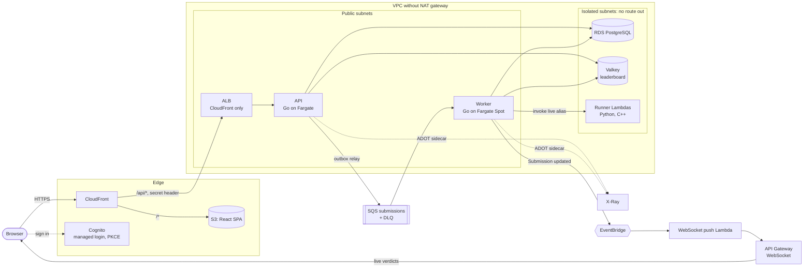
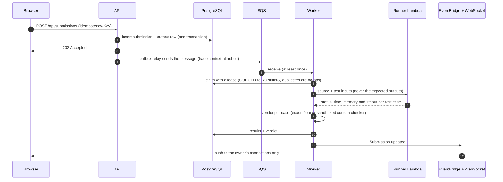
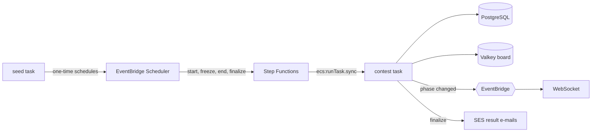
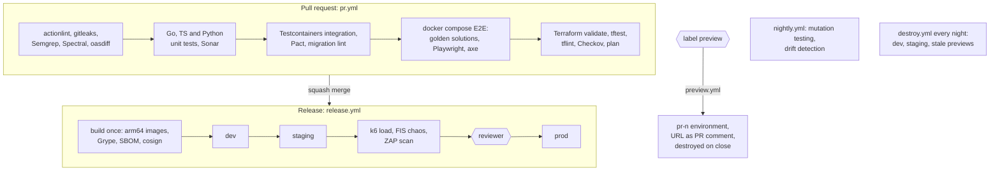
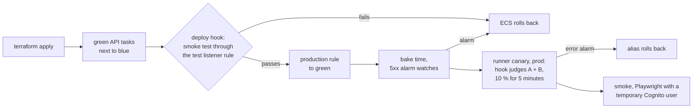

# CodeArena

A cloud-native online judge on AWS. Solve programming problems in the browser, submit
Python or C++ code, watch the verdict of every test case arrive live, and compete in
contests with an ICPC-style leaderboard.

The project has two goals: a non-trivial distributed system (sandboxed code execution,
queue-driven workers, real-time updates, scheduled contests), and a delivery pipeline with
many test layers, quality gates and progressive delivery with automatic rollback.

> **Status:** feature-complete for the plan in [docs/PLAN.md](docs/PLAN.md); open items and
> AWS verifications are tracked in [docs/PROGRESS.md](docs/PROGRESS.md).

## Demo


Recorded with Playwright against the local stack (`make demo-video`).

## Highlights

- **Sandboxed execution:** untrusted code runs in runner Lambdas (Firecracker microVMs) in
  subnets without any route out, with CPU, memory, process, file and output limits; the
  runner never sees expected outputs ([ADR-0003](docs/adr/0003-sandbox-on-lambda.md)).
- **Queue-driven judge:** transactional outbox, SQS with a DLQ, Go workers on Fargate Spot
  with leased, idempotent claims, a sweeper for stuck submissions, scaling to zero on queue
  backlog ([ADR-0011](docs/adr/0011-transactional-outbox-and-leased-claims.md)).
- **Real time:** verdicts and leaderboards pushed through EventBridge and API Gateway
  WebSockets with single-use tickets ([ADR-0015](docs/adr/0015-live-updates-websocket-tickets.md)).
- **Contests:** phases from the clock, EventBridge Scheduler and Step Functions for the
  lifecycle, Valkey leaderboard with freeze and a Postgres fallback, result e-mails through SES
  ([ADR-0016](docs/adr/0016-contests-clock-phases-valkey-step-functions.md)).
- **No paid AI calls:** the first plan had Bedrock hints; they were removed, and IAM denies
  Bedrock, so public traffic cannot turn into model cost ([ADR-0021](docs/adr/0021-remove-ai-hints.md)).
- **Delivery:** GitHub Actions with OIDC (no AWS keys), images built once and promoted
  dev → staging → prod, preview environment per pull request, ECS blue/green with a
  smoke-test hook and a CodeDeploy canary for the runners, alarm-based rollback
  ([ADR-0019](docs/adr/0019-preview-environments-shared-vpc.md), [ADR-0020](docs/adr/0020-blue-green-api-canary-runners.md)).
- **Observability:** one OpenTelemetry trace per submission across API, outbox, SQS, worker,
  runner and WebSocket push (ADOT to X-Ray), CloudWatch dashboard, Synthetics canary
  ([ADR-0018](docs/adr/0018-opentelemetry-traces-adot-xray.md)).

## Architecture



Each environment (dev, staging, prod, `pr-<n>`) is the same Terraform module
(`infra/modules/app`) with different variables, so environments never differ in structure.

### One submission



A crashed worker's lease expires and SQS delivers again; submissions that stay stuck are
requeued by the sweeper, and exhausted ones end as `IE`.

### Contest lifecycle



Phases come from the clock, so who may submit never depends on a schedule firing on time;
the lifecycle steps refresh caches, push events and send the results.

## Delivery pipeline



The PR stages are drawn in sequence for reading; in `pr.yml` they run as parallel jobs
that start only when their paths changed, and `CI OK` gates the merge.

Every deployment (`deploy-environment.yml`) runs the same steps: targeted apply, migrate and
seed as one-off ECS tasks, full apply, then a safe rollout and post-deploy tests.



## Testing

| Layer | What | Where |
|---|---|---|
| Unit | Go (race detector), Vitest + Testing Library, pytest for runners and Lambdas | `make test`, `make fe-check`, `make py-test` |
| Sandbox | probe programs through the runner images without network: limits, file system, environment, leftover processes | `make sandbox-suite` |
| Golden | every problem has one solution per expected verdict (AC, WA, TLE, MLE, RE, CE, ...) in Python and C++ | `tests/golden`, `make golden` |
| Integration | Testcontainers PostgreSQL, ElasticMQ and Valkey: claims, outbox, sweeper, API with an N+1 query guard | `make test-integration` |
| Contract | OpenAPI response validation in every API test, Pact SPA ↔ API, AsyncAPI for WebSocket messages | `make pact` |
| End to end | golden solutions through the whole local chain, Playwright with page objects and axe | `make e2e`, `make fe-e2e` |
| Post-deploy | Playwright against CloudFront: security headers, edge rules, signed-in submissions | `frontend/e2e/deployed` |
| Non-functional | k6 judge latency and lost submissions, worker scaling, FIS worker kill, OWASP ZAP | `nonfunctional.yml` |
| Mutation | Gremlins (Go judge logic), Stryker (SPA) with thresholds | `nightly.yml` |
| Infrastructure | `terraform test` with mocked providers, tflint, Checkov, nightly drift detection | `infra/modules/app/tests` |

## Repository layout

```
backend/            Go: cmd/api, cmd/worker, cmd/judge, cmd/seed, cmd/contest, cmd/migratediff
frontend/           React + Vite + TypeScript SPA (Monaco, typed API client, Playwright, Pact)
runners/            runner protocol (JSON Schema), sandbox core, Python and C++ Lambda images
lambdas/            Python Lambdas: ws (WebSocket), deploy-hook (rollout smoke tests)
contracts/          OpenAPI 3.1 and AsyncAPI contracts
tests/              golden problems, sandbox security, performance (k6), security (ZAP)
infra/bootstrap/    one-time account foundation: state bucket, GitHub OIDC roles, budget
infra/shared/       account-wide resources (ECR repositories)
infra/modules/      Terraform modules (app, backend, network, runner-lambda, contests, ...)
infra/envs/         dev, staging, prod stacks
infra/preview/      shared preview VPC and the per-PR stack
docs/               plan, progress, setup guide, ADRs
.github/workflows/  CI/CD pipelines
```

## Getting started

Prerequisites and the one-time AWS and GitHub setup: [docs/SETUP.md](docs/SETUP.md).

```bash
make help         # list targets
make local-up     # full stack in Docker: Postgres, Valkey, ElasticMQ, runners, API, worker (+ migrations, seed)
make fe-dev       # SPA on http://localhost:5173 (sign in with any lowercase name)
make e2e          # golden solutions through the whole chain
make fe-e2e       # Playwright browser tests + accessibility scan
make local-traces # the same stack with traces in Jaeger (http://localhost:16686)
make demo-video   # record docs/media/demo.gif (needs make local-up)
make test         # Go unit tests
make golden       # every golden solution must get its expected verdict (make runner-up first)
make sandbox-suite # runner hardening: limits, no network, read-only root, no leftovers
make judge SRC=tests/golden/a-plus-b/solutions/ac.py
make tf-validate  # validate all Terraform stacks
make check        # every local check
```

## Decisions

Architecture decision records are in [docs/adr](docs/adr), from the monorepo
([0002](docs/adr/0002-monorepo.md)) and the Lambda sandbox ([0003](docs/adr/0003-sandbox-on-lambda.md))
to preview environments ([0019](docs/adr/0019-preview-environments-shared-vpc.md)) and
blue/green with canaries ([0020](docs/adr/0020-blue-green-api-canary-runners.md)).

## Cost control

Everything is Terraform, so an environment exists only while it is needed: dev and staging
are destroyed every night, previews when their pull request closes, and nothing runs a NAT
gateway ([ADR-0005](docs/adr/0005-network-without-nat.md)). Budget alerts are part of the
bootstrap stack.
